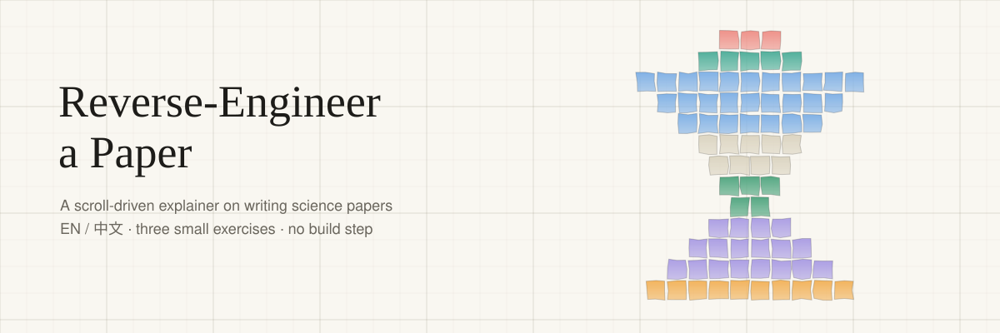
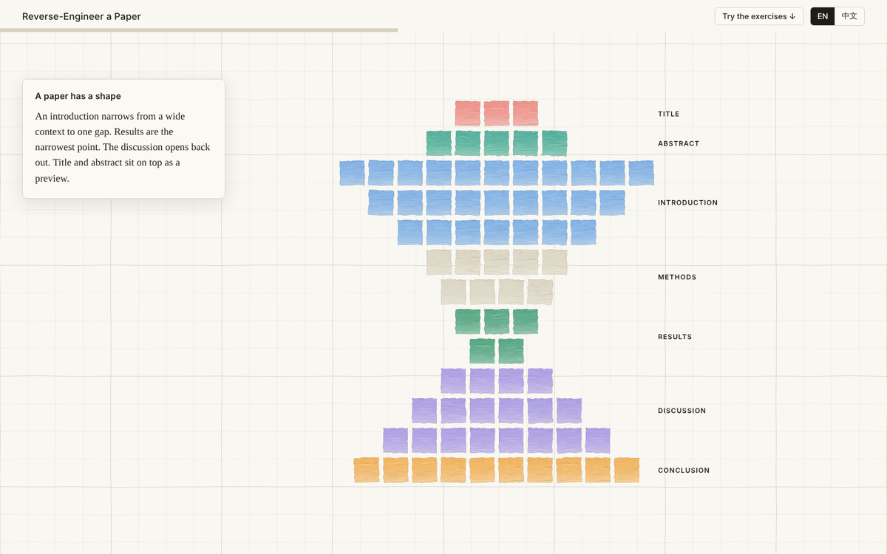
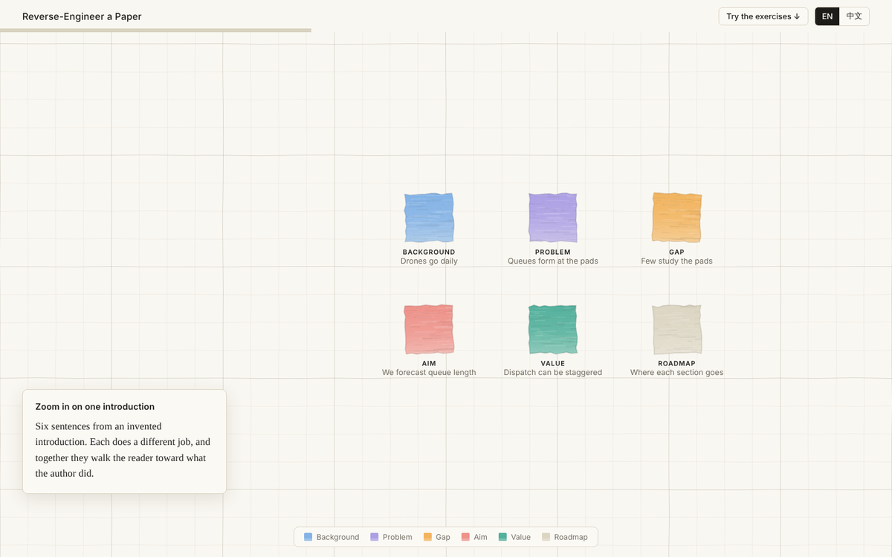
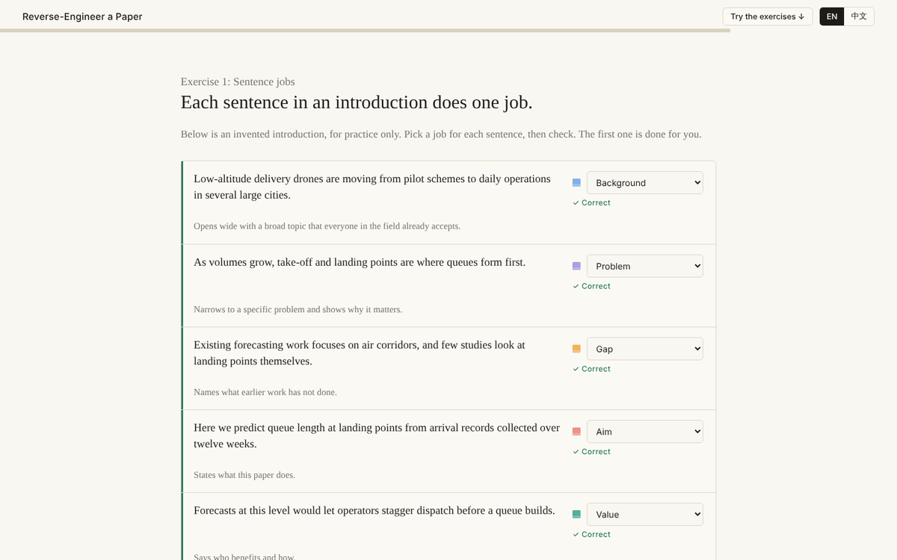

<div align="center">



<br>

[English](README.md) · **中文**

[](https://shentonyan.github.io/reverse-engineer-a-paper/)
[](LICENSE)
[](https://github.com/shentonyan/reverse-engineer-a-paper/actions/workflows/check.yml)


</div>

一个单页、随滚动展开的讲解页，介绍用“逆向工程”方法写科研论文。每个水彩质感的方块代表论文里的一句话。滚动时，方块重新排列，展示论文是怎样组织的、每句话有什么作用，以及怎样从自己领域的文章里学到这套写法。后面附三个小练习。

页面支持中英双语，跟随系统的浅色 / 深色主题，手机上也能用。

<p align="center">
  
</p>

## 目录

- [页面里能做什么](#页面里能做什么)
- [场景一览](#场景一览)
- [本地运行](#本地运行)
- [用 GitHub Pages 上线](#用-github-pages-上线)
- [改成你自己的](#改成你自己的)
- [测试](#测试)
- [复用封面](#复用封面)
- [仓库结构](#仓库结构)
- [来源与致谢](#来源与致谢)
- [许可证](#许可证)

## 页面里能做什么

| | |
|---|---|
| **滚动** | 一块固定的画布上有七个场景，方块从一种排列飞向下一种。右侧的圆点可直接跳到任一场景。 |
| **练习一** | 为一段虚构引言里的每句话选功能（背景、问题、研究空白、目的、价值、文章结构），再检查答案。 |
| **练习二** | 把动词在过去时、现在时和情态动词之间切换，看同一个论断读起来有什么不同。 |
| **练习三** | 为自己的草稿勾选八个问题的清单，勾选状态保存在浏览器本地。 |
| **语言** | 顶部可切换 EN / 中文，会记住你的选择。 |

<table>
<tr>
<td width="50%"></td>
<td width="50%"></td>
</tr>
<tr>
<td align="center"><sub>六句话，六种功能</sub></td>
<td align="center"><sub>练习一，已检查答案</sub></td>
</tr>
</table>

## 场景一览

| # | 场景 | 方块展示的内容 |
|---|---|---|
| 0 | 开场 | 方块散落在整个页面。 |
| 1 | 论文由句子构成 | 铺满整张纸的方块，一个方块一句话（示意，非真实数据）。 |
| 2 | 每个部分各有职责 | 按引言、方法、结果、讨论、结论分色。 |
| 3 | 拿一篇引言放大看 | 虚构引言里的六句话，各自标出功能。 |
| 4 | 论文是有形状的 | 沙漏：引言宽，结果窄，讨论再变宽。 |
| 5 | 学方法，而不是抄文字 | 四步循环：建模、挖词、掌握、更新。 |
| 6 | 轮到你的论文了 | 回到整张纸，附一个可在自己领域试用的简短做法。 |

## 本地运行

无需构建，运行时也没有依赖。用浏览器直接打开 `index.html`，或者起一个本地服务：

```bash
python -m http.server 8000
# 然后访问 http://localhost:8000
```

页面会从 Google Fonts 加载两款字体（Newsreader 和 Hanken Grotesk）。没有网络时会回退到系统字体。

## 用 GitHub Pages 上线

1. 把仓库推送到 GitHub。
2. 打开 **Settings → Pages**。
3. 在 **Build and deployment** 下选择 **Deploy from a branch**，分支选 `main`，目录选 `/ (root)`。
4. 一两分钟后即可通过 `https://<你的用户名>.github.io/<仓库名>/` 访问。

## 改成你自己的

- **文字与翻译**：`assets/content.js`。每一项都是 `{ en, zh }`，包括练习的句子、时态例子、清单和画布上的标注。
- **页面文案**：在 `index.html` 里，英文是元素本身的内容，中文放在 `data-zh` 属性里。
- **颜色**：`assets/style.css` 顶部的一组 CSS 变量（深色值在其后）。方块的颜色在 `assets/app.js` 的 `PAL` 对象中。
- **形状**：每个场景都在 `assets/app.js` 的 `build()` 里生成。一个场景就是一组方块的目标位置、大小和颜色，新增排列只需新增一段。见 [CONTRIBUTING.md](CONTRIBUTING.md#adding-a-scene)。
- **滚动长度**：固定画布的外层是 `.tall`，高度由场景数量决定。

## 测试

```bash
npm install
npx playwright install chromium
npm test
```

冒烟测试会在真实浏览器里打开页面，检查 26 项：脚本无报错、七个场景都能到达、画布确实画出了内容、桌面 / 手机 / 竖屏平板都没有横向溢出、练习能正确打分、语言切换和勾选在刷新后保留、深色主题正常。每次推送时 GitHub Actions 都会运行它。

## 复用封面

本页顶部的封面由一个小脚本 `scripts/make-cover.py` 生成（只用 Python 标准库）。它把水彩质感的方块画在方格纸上，输出一张 SVG，新项目一条命令就能得到风格一致的封面：

```bash
python scripts/make-cover.py --title "我的项目" --subtitle "一句话介绍" \
    --shape ring --out docs/img/banner.svg
python scripts/make-cover.py --title "我的项目" --shape pyramid \
    --size 1200x630 --out docs/img/social-card.svg   # 链接预览图
```

形状可选 `hourglass`、`ring`、`pyramid`、`scatter`，其余参数见 `--help`。

## 仓库结构

```
.
├── index.html              页面结构和元信息
├── assets/
│   ├── style.css           配色、布局、响应式规则
│   ├── content.js          全部文字和练习数据（中 / 英）
│   ├── app.js              画布引擎、场景、练习
│   └── favicon.svg
├── tests/                  静态服务器和 Playwright 冒烟测试
├── scripts/make-cover.py   封面 / 分享图生成脚本
├── docs/img/               横幅、分享图、截图
├── .github/workflows/      CI（运行 npm test）
├── CONTRIBUTING.md
├── CHANGELOG.md
├── README.md               英文说明
├── README.zh-CN.md         本文件
└── LICENSE                 MIT
```

## 来源与致谢

- 文字和示例均为原创，示例引言是为演示而虚构的，并非来自真实研究。
- 方法灵感来自 Hilary Glasman-Deal，《Science Research Writing for Native and Non-native Speakers of English》第 2 版，World Scientific，2020。本仓库不包含也不复刻该书内容，完整的写作模型、词汇清单和练习请阅读原书。
- 视觉思路（满屏方块画布加小型浮动卡片）受 Anthropic 的 “Scenarios for our Economic Future” 页面启发，没有使用该页面的任何代码、字体或素材。
- 字体：[Newsreader](https://fonts.google.com/specimen/Newsreader) 和 [Hanken Grotesk](https://fonts.google.com/specimen/Hanken+Grotesk)，均为 SIL 开源字体许可，由 Google Fonts 提供。

## 许可证

[MIT](LICENSE)
